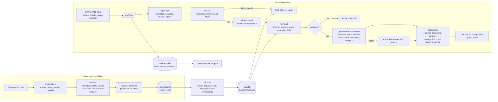

# Architecture

## Request path

1. **Sanitise and normalise.** `sanitize` caps input at 800 characters and strips control characters.
   `guardrails.normalise` applies NFKC and removes zero-width and bidi control characters, so obfuscated
   text routes like plain text.
2. **Input rails** (`config/guardrails.yaml`).
   - Long base64 or hex payloads are treated as injection.
   - A narrow unsafe list gets a fixed refusal.
   - Personal investment-advice requests are marked, so the answer carries a disclaimer.
3. **Route.** `Router` (rules from `config/router.yaml`) decides language, intent and brand. Injection
   patterns, greetings and handoff requests are answered without retrieval or a model call.
4. **Listing search.** Listing searches run validated SQL filters (type, purpose, city, price, beds,
   area). They return cards with no model call, so prices come straight from the data.
5. **Retrieve.** Everything else is ranked three ways, fused by reciprocal-rank fusion (weights in
   `config/retrieval.yaml`):
   - FTS5 BM25.
   - Cosine over int8-ONNX multilingual embeddings.
   - **Graph expansion.** Entities named in the question (EN or AR aliases) seed a one-hop walk over
     the entity graph. The ranking is the chunks that evidence those edges, plus chunks naming several
     seeds. A question that asks for a type ("projects in Oman") ranks neighbours of that type first.
6. **Confidence gate.** The gate refuses when the best of the top three passages is not semantically
   close enough. Every hit carries its true cosine, including graph-only hits, so expansion cannot fool
   the gate. Questions with no brand, domain word or known entity must clear a higher bar.
7. **Generate.** The model sees:
   - a system prompt from `prompts/`;
   - the last six turns, PII-redacted;
   - the sources in delimited `<source>` blocks;
   - the graph relations whose evidence is among those sources, each with its source numbers.
8. **Output rails.** These run on the full answer, and the UI shows each check:
   - invalid citation markers are removed, and citation coverage is measured;
   - each factual sentence is checked for support: content-word overlap with the cited passage, or
     semantic similarity for cross-language answers;
   - numbers absent from the sources are flagged;
   - a run of words copied from the system prompt replaces the answer;
   - contact details not in the sources are redacted;
   - a sentence citing two companies is flagged;
   - "guaranteed return" language adds a disclaimer.
9. **Follow-ups and trace.** Follow-up questions come from the graph neighbourhood of the question or of
   the cited passages. A per-step trace (route, retrieval mix, model, checks, timings) is shown under
   the answer.

## Knowledge graph

`config/graph.yaml` declares the entities: their types (company, project, partner brand, place,
exchange, person), names, and EN/AR aliases.

How the build turns text into edges:
- **Matching.** The build matches entities in every chunk with one longest-first alternation, so
  "London Stock Exchange" never also counts as "London". Hyphenated attributes ("London-listed") are not
  mentions.
- **Edges.** Two entities in the same sentence get an edge labelled by their type pair ("project|place"
  → "located in").
- **Nearest-entity rule.** For location and branding relations, only the nearest entity of the other
  type in the sentence is linked. This stops list sentences ("projects in Dubai, Oman and Jeddah") from
  cross-linking.
- **Evidence.** Each edge keeps the chunk rowids that evidence it.

The graph never adds facts the text does not contain. It adds reach and structure:
- reach: aggregation and multi-hop questions, and Arabic entry points into English sources;
- structure: relations handed to the model and shown to the user.

`GET /api/graph` serves the explorer.

## Why these choices (short; see `adr/`)

- **Rules for routing, not model tool calls.** Free models drift and rate-limit; rules are testable.
- **SQLite + FTS5 + a NumPy matrix instead of a vector DB.** 406 chunks fit in 300 KB; one file, no
  server.
- **int8 ONNX + SentencePiece instead of the packaged embedding stack.** 275 MB RSS instead of 570 MB.
- **No LangGraph/LangChain at runtime.** The flow is a handful of functions, and the dependency weight
  would not fit the 512 MB budget alongside the embedder. The flow is still an explicit graph
  (`pipeline.py`).
- **A rules-and-gazetteer entity graph instead of LLM-extracted GraphRAG.** It is deterministic and free
  to build, and every edge traces to a sentence (ADR 0006).
- **Guardrails as code, not a second model call.** They run in about 150 ms on the free tier and are
  unit tested (ADR 0007).
