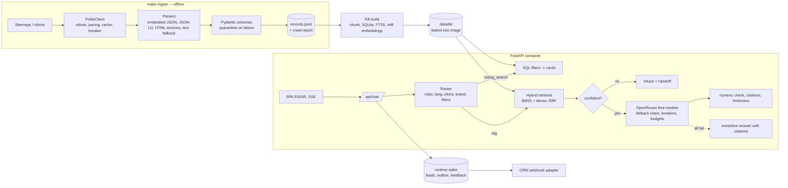

# Architecture

## Request path

1. `sanitize` caps input at 800 chars and strips control characters.
2. `Router` (rules from `config/router.yaml`) decides language, intent and brand. Injection patterns,
   greetings and handoff requests are answered without retrieval or a model call.
3. Listing searches run validated SQL filters (type, purpose, city, price, beds, area) and return cards
   with no model call at all, so prices come straight from the data.
4. Everything else is retrieved with hybrid search: FTS5 BM25 and cosine over int8-ONNX embeddings,
   fused with reciprocal-rank fusion (weights in `config/retrieval.yaml`). If a single brand is named,
   retrieval is restricted to it.
5. A confidence gate refuses when the best of the top three passages is not semantically close enough.
   Questions with no brand, domain word or known entity must clear a higher bar, which is what keeps
   "capital of France" from being answered from a project called "Parisiana".
6. The model sees a system prompt from `prompts/`, the last six turns (PII-redacted) and the sources in
   delimited `<source>` blocks, with the instruction that they are data, not instructions.
7. After streaming, every number in the answer is checked against the retrieved text; unsupported
   ones are flagged to the user and counted in `/metrics`.

## Why these choices (short; see `adr/`)

- Rules for routing, not model tool calls: free models drift and rate-limit; rules are testable.
- SQLite + FTS5 + a NumPy matrix instead of a vector DB: 406 chunks fit in 300 KB; one file, no server.
- int8 ONNX + SentencePiece instead of the packaged embedding stack: 275 MB RSS instead of 570 MB.
- No LangGraph/LangChain at runtime: the flow is six functions; the dependency weight would not fit
  the 512 MB budget alongside the embedder. The flow is still an explicit graph (`pipeline.py`).
